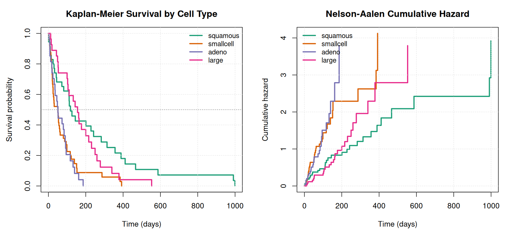
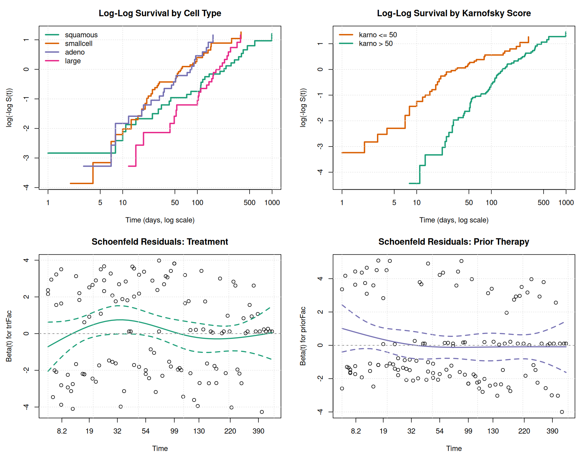
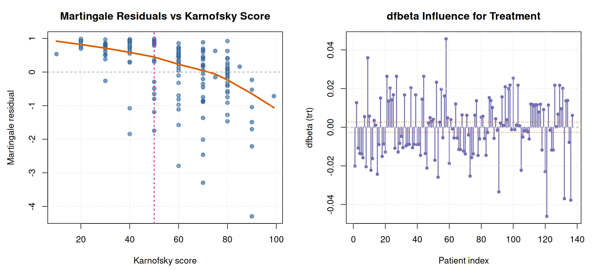
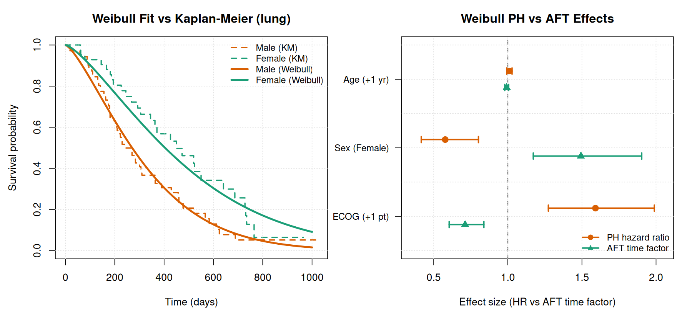
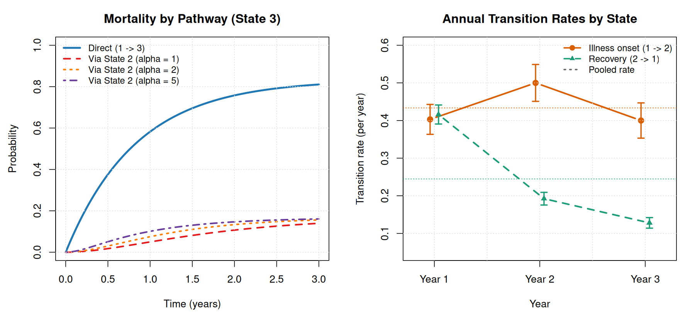

# Survival and Multi-State Event History Analysis in R

This repository contains R scripts and diagnostic plots for three survival and event-history studies:

1. **Study 1 - Non-Proportional Hazards & Stratified Cox Regression (`veteran` trial, N = 137):** Kaplan-Meier and Nelson-Aalen estimation, 1-year Restricted Mean Survival Time (RMST), Schoenfeld/Martingale/dfbeta residual checks, and stratified Cox models with treatment-by-prior-therapy contrasts (`R/nonparam.R`, `R/coxDiag.R`).
2. **Study 2 - Weibull PH vs. AFT Parameterization & Poisson Regression (`lung` cohort, N = 228):** Comparing Weibull Proportional Hazards (PH) and Accelerated Failure Time (AFT) models alongside constant-hazard Poisson regression with log person-time offsets (`R/weibullAft.R`).
3. **Study 3 - Three-State Reversible Illness-Death Process (10,080 person-years):** Continuous-time Markov and semi-Markov transition models, likelihood ratio testing for time-varying recovery rates, and 3-year piecewise-constant sojourn times (`R/multistate.R`).

---

## Study 1: VA Lung Cancer Trial (`veteran`, N = 137)

The Veterans Administration lung cancer dataset follows 137 patients (128 deaths) randomised to standard therapy (`trt = 1`, n = 69) or test chemotherapy (`trt = 2`, n = 68). Covariates include histological cell type (`squamous`, `smallcell`, `adeno`, `large`), baseline Karnofsky performance score (`karno`, split at <= 50 vs. > 50), and prior therapy (`prior = 0` for no, `prior = 10` for yes).

### Non-Parametric Survival & 1-Year RMST

At event times `t_j` with `d_j` deaths among `Y_j` patients at risk, we estimate survival and cumulative hazard using the Kaplan-Meier and Nelson-Aalen (`ctype = 1`) estimators:

```text
S_hat(t)      = prod_{t_j <= t} (1 - d_j / Y_j)
Lambda_hat(t) = sum_{t_j <= t} (d_j / Y_j)
RMST(365)     = int_0^365 S_hat(t) dt
```

Pointwise 95% confidence intervals use the complementary log-log transformation (`conf.type = "log-log"`) so bounds stay within `[0, 1]`. Because survival curves cross and violate proportional hazards across cell types, we report 1-year Restricted Mean Survival Time (RMST) alongside median survival, and test group differences with both the unweighted Log-Rank test (`rho = 0`) and the Peto-Peto test (`rho = 1`, which gives more weight to early deaths).

| Group | Stratum | n | Events | Median (95% CI, days) | 1-Yr RMST (SE, days) | RMST 95% CI | Log-Rank p | Peto-Peto p |
| --- | --- | --- | --- | --- | --- | --- | --- | --- |
| `celltype` | `squamous` | 35 | 31 | 118.0 (44, 242) | 170.64 (24.23) | (123.14, 218.14) | 1.27e-05 | 1.95e-04 |
| `celltype` | `smallcell` | 48 | 45 | 51.0 (24, 61) | 77.64 (13.97) | (50.25, 105.02) | 1.27e-05 | 1.95e-04 |
| `celltype` | `adeno` | 27 | 26 | 51.0 (24, 90) | 65.56 (9.93) | (46.09, 85.02) | 1.27e-05 | 1.95e-04 |
| `celltype` | `large` | 27 | 26 | 156.0 (100, 216) | 162.23 (20.46) | (122.13, 202.34) | 1.27e-05 | 1.95e-04 |
| `karno1` | `karno <= 50` | 52 | 50 | 20.5 (16, 33) | 61.86 (12.63) | (37.11, 86.60) | 1.08e-07 | 2.98e-11 |
| `karno1` | `karno > 50` | 85 | 78 | 112.0 (95, 139) | 147.97 (12.62) | (123.24, 172.70) | 1.08e-07 | 2.98e-11 |
| `trt` | `Standard` | 69 | 64 | 103.0 (54, 126) | 118.97 (13.02) | (93.45, 144.49) | 0.928 | 0.351 |
| `trt` | `Test` | 68 | 64 | 52.5 (43, 90) | 112.40 (14.87) | (83.25, 141.56) | 0.928 | 0.351 |

Survival differs strongly by histological subtype and baseline Karnofsky status: over the first year, patients with `karno > 50` live an average of 147.97 days compared to 61.86 days for `karno <= 50` (a difference of 86.11 days). Unadjusted treatment arm shows no overall difference (Log-Rank p = 0.928).



### Stratified Cox PH Regression & Residual Diagnostics

In an unstratified Cox model, both the complementary log-log curves (`log(-log S(t))`) and the Schoenfeld residual test (`cox.zph`) show clear violations of proportional hazards for cell type (p = 0.0056) and Karnofsky group (p = 7.1e-05; global test p = 9.5e-05).

To fix this without forcing parametric shapes on the baseline hazard, we stratify on the 8 combinations of `celltype` and `karno1` (`s = 1, ..., 8`) and test whether prior therapy modifies the treatment effect:

```text
lambda_s(t | x) = lambda_{0s}(t) * exp(b_1 * trt + b_2 * prior + b_3 * (trt * prior))
```

Because `prior` is coded as `0` (no) and `10` (yes), the log hazard ratio for Test vs. Standard treatment is `b_1` when `prior = 0` and `b_1 + 10 * b_3` when `prior = 10`, with variance taken from `vcov(fitCox)`:

```text
Var(b_1 + 10 * b_3) = Var(b_1) + 100 * Var(b_3) + 20 * Cov(b_1, b_3)
```

| Model | Contrast | log(HR) | SE | HR | 95% CI | Wald p | Schoenfeld p |
| --- | --- | --- | --- | --- | --- | --- | --- |
| Stratified Main Effects | Test vs. Standard (`trt`) | 0.1189 | 0.2037 | 1.1262 | (0.7555, 1.6789) | 0.5595 | 0.5257 |
| Stratified Main Effects | Prior Yes vs. No (`prior = 10 vs 0`) | 0.1024 | 0.2156 | 1.1078 | (0.7259, 1.6905) | 0.6350 | 0.2258 |
| Stratified Interaction | Test vs. Standard (`Prior = No`) | 0.3036 | 0.2396 | 1.3548 | (0.8470, 2.1670) | 0.2051 | - |
| Stratified Interaction | Test vs. Standard (`Prior = Yes`) | -0.3153 | 0.3628 | 0.7296 | (0.3583, 1.4854) | 0.3848 | - |
| Stratified Interaction | Interaction (`Prior Yes / Prior No`) | -0.6189 | 0.4266 | 0.5385 | (0.2334, 1.2426) | 0.1468 | - |

After stratifying on `celltype` and `karno1`, the global Schoenfeld test passes cleanly (p = 0.40). Among treatment-naive patients (`prior = 0`), test chemotherapy has HR = 1.3548 (95% CI: 0.8470, 2.1670), whereas among previously treated patients (`prior = 10`) it has HR = 0.7296 (95% CI: 0.3583, 1.4854), though the interaction is not statistically significant (p = 0.1468).



Null Martingale residuals plotted against continuous Karnofsky score confirm why splitting at `karno = 50` is needed, and `dfbeta` influence plots show that no single patient shifts `b_trt` by more than 0.046 (well below SE = 0.2037).



---

## Study 2: NCCTG Lung Cohort - Weibull PH vs. AFT & Poisson GLM (`lung`, n = 227)

In the second study, we analyze 227 complete cases (164 deaths over 69,522 person-days) from the NCCTG advanced lung cancer cohort (`survival::lung`), modeling survival as a function of `age`, `sex` (`1 = Male`, `2 = Female`), and ECOG performance score (`ph.ecog`).

### Connecting Weibull PH, Weibull AFT, and Poisson Regression

The Weibull distribution is the only parametric survival family that is simultaneously a Proportional Hazards (PH) model and an Accelerated Failure Time (AFT) model:

```text
PH form:         lambda(t | x) = gamma * lambda_0 * t^(gamma - 1) * exp(x' * beta_PH)
AFT form:        log(T)        = mu + x' * beta_AFT + sigma * W,    where sigma = 1 / gamma
Parameter link:  beta_AFT      = -beta_PH / gamma
```

A negative PH coefficient (`beta_PH < 0`, lower hazard of death) corresponds to a positive AFT coefficient (`beta_AFT > 0`, longer survival time).

When `gamma = 1` (constant exponential hazard), the survival log-likelihood for events `d_i` and follow-up times `t_i` is identical to a Poisson GLM with a log-time offset (`glm(event ~ age + sex + ph.ecog, offset = log(time), family = poisson)`). For the overall constant hazard `lambda_hat = D / T_total` (2.3590 deaths per 1,000 person-days), computing the 95% confidence interval on the log scale (`lambda_hat * exp(+/- 1.96 / sqrt(D))`, `[2.0242, 2.7491]`) avoids the small-sample skew of the raw linear interval (`[1.9979, 2.7200]`).

| Covariate | beta_PH (SE) | PH HR (95% CI) | PH p | beta_AFT (SE) | AFT Factor exp(beta_AFT) | -beta_PH / gamma | Poisson GLM HR |
| --- | --- | --- | --- | --- | --- | --- | --- |
| `age` (per year) | 0.0102 (0.0092) | 1.0103 (0.9922, 1.0287) | 0.268 | -0.0075 (0.0068) | 0.9926 (0.9795, 1.0058) | -0.0075 | 1.0103 |
| `sex` (Female vs. Male) | -0.5486 (0.1673) | 0.5778 (0.4162, 0.8020) | 0.00104 | 0.4011 (0.1237) | 1.4935 (1.1718, 1.9033) | 0.4011 | 0.6011 |
| `ph.ecog` (per 1-unit) | 0.4646 (0.1137) | 1.5913 (1.2735, 1.9884) | 4.38e-05 | -0.3396 (0.0835) | 0.7120 (0.6046, 0.8386) | -0.3396 | 1.4993 |

With estimated Weibull shape `gamma = 1.3678` (`sigma = 0.7311`), female patients have a 42.2% lower death hazard (HR = 0.5778, p = 0.00104), which translates under the AFT parameterization to a 49.4% longer survival time (`exp(beta_AFT)` = 1.4935). Each 1-point worsening in ECOG score increases the death hazard by 59.1% (HR = 1.5913, p = 4.38e-05) and shortens survival time by 28.8% (`exp(beta_AFT)` = 0.7120).



---

## Study 3: Three-State Reversible Illness-Death Process (10,080 Person-Years)

The third study models transitions across **State 1 (Healthy)**, **State 2 (Illness)**, and **State 3 (Death)** (`R/multistate.R`). We first compare direct mortality (`1 -> 3`) and illness-mediated mortality (`1 -> 2 -> 3`) under Markov and semi-Markov (duration-dependent) transition intensities, and then analyze a 3-year reversible cohort (2,480 person-years in State 1; 7,600 person-years in State 2).

### Testing Time-Homogeneity & Estimating 3-Year Sojourn Times

Given transition counts `N_{klr}` and person-years `R_{kr}` in year `r = 1, 2, 3`, the year-specific and pooled transition rate MLEs are `lambda_hat_{klr} = N_{klr} / R_{kr}` and `lambda_hat_{kl} = N_{kl.} / R_{k.}`. We test whether transition rates are constant across the 3 years (`df = 8`) using the Poisson likelihood ratio statistic:

```text
W = 2 * sum_{k, l} sum_{r=1}^3 N_{klr} * log(lambda_hat_{klr} / lambda_hat_{kl})
```

Because time-homogeneity is rejected (W = 460.503, p = 2.08e-94), the naive constant-rate sojourn formula `1 / lambda_{k.}` is invalid. Letting `lambda_{k.,r} = sum_{l != k} lambda_{klr}` be the total exit rate from state `k` in year `r`, we integrate the piecewise-exponential survival curve over `[0, 3]` to get the **3-year restricted single-spell sojourn time**:

```text
mu_k(3) = [1 - exp(-lambda_{k.,1})] / lambda_{k.,1}
          + exp(-lambda_{k.,1}) * [1 - exp(-lambda_{k.,2})] / lambda_{k.,2}
          + exp(-(lambda_{k.,1} + lambda_{k.,2})) * [1 - exp(-lambda_{k.,3})] / lambda_{k.,3}
```

Standard errors follow from the delta method across the three independent annual rates (`Var(lambda_hat_{k.,r}) = N_{k.,r} / R_{kr}^2`), and total 3-year state occupation times (allowing re-entry after recovery or relapse) are computed from the matrix exponential `P(r - 1, r - 1 + u) = exp(Q_r * u)`.

| Transition / Quantity | Year 1 | Year 2 | Year 3 | Pooled / 3-Yr Estimate | SE | 95% CI | LRT W |
| --- | --- | --- | --- | --- | --- | --- | --- |
| `1 -> 2` (Illness onset / yr) | 0.4031 | 0.5000 | 0.4000 | 0.4335 (pooled) | 0.0132 | (0.4076, 0.4594) | 11.779 |
| `1 -> 3` (Healthy death / yr) | 0.0010 | 0.0013 | 0.0014 | 0.0012 (pooled) | 0.0007 | (-0.0002, 0.0026) | 0.058 |
| `2 -> 1` (Recovery / yr) | 0.4160 | 0.1923 | 0.1280 | 0.2447 (pooled) | 0.0057 | (0.2336, 0.2559) | 447.539 |
| `2 -> 3` (Illness death / yr) | 0.0008 | 0.0004 | 0.0012 | 0.0008 (pooled) | 0.0003 | (0.0002, 0.0014) | 1.127 |
| **State 1 Sojourn `mu_1(3)` (Piecewise 3-yr, yr)** | - | - | - | **1.6808** | **0.0293** | **(1.6234, 1.7381)** | - |
| **State 2 Sojourn `mu_2(3)` (Piecewise 3-yr, yr)** | - | - | - | **1.9273** | **0.0205** | **(1.8871, 1.9675)** | - |
| State 1 Total Occupation `Psi_{11}(3)` (with re-entry, yr) | - | - | - | 1.8853 | - | - | - |
| State 2 Total Occupation `Psi_{22}(3)` (with re-entry, yr) | - | - | - | 2.2818 | - | - | - |

Almost all of the non-homogeneity (W = 447.539 out of W = 460.503, or 97.2%) comes from the recovery rate `2 -> 1` dropping from 0.4160 / yr in Year 1 to 0.1923 / yr in Year 2 and 0.1280 / yr in Year 3. Over the 3-year window, the restricted single-spell sojourn time is 1.6808 years in State 1 and 1.9273 years in State 2 (or 1.8853 and 2.2818 years when accounting for re-entries).



---

## Files & Running the Code

* `run.R`: Master script that runs all three studies and saves the tables and plots.
* `R/prep.R`: Loads `veteran` and `lung` and sets up the factor variables (`karno1`, `prior`, `sex`).
* `R/nonparam.R`: Kaplan-Meier, Nelson-Aalen, 1-year RMST, Log-Rank, and Peto-Peto tests (`figures/kmCurve.png`, `results/rmstSum.csv`).
* `R/coxDiag.R`: Stratified Cox PH models, interaction contrasts, and Schoenfeld/Martingale/dfbeta diagnostics (`figures/phDiag.png`, `figures/coxResid.png`, `results/coxCont.csv`).
* `R/weibullAft.R`: Weibull PH vs. AFT models and Poisson regression with log-time offset (`figures/weibullFit.png`, `results/weibullDual.csv`).
* `R/multistate.R`: Markov and semi-Markov illness-death models, homogeneity likelihood ratio test, and 3-year sojourn times (`figures/stateOcc.png`, `results/stateSoj.csv`).

To run everything from the terminal (requires standard R and the `survival` package):

```bash
Rscript run.R
```
